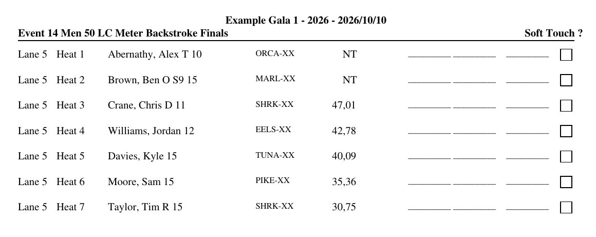
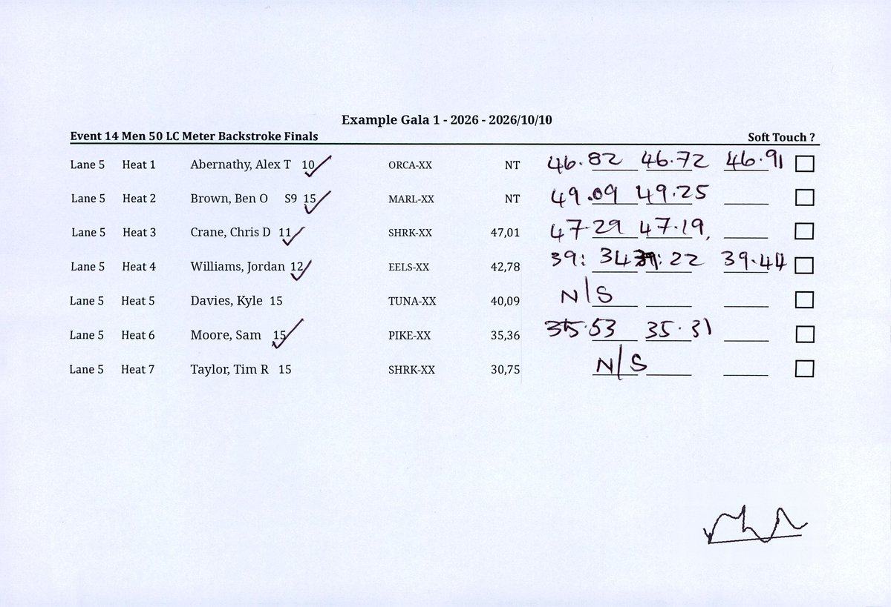
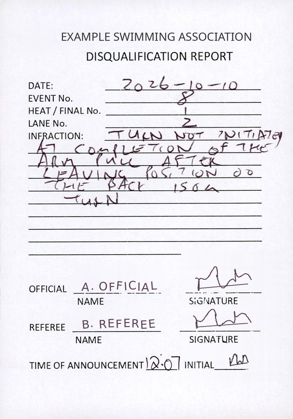
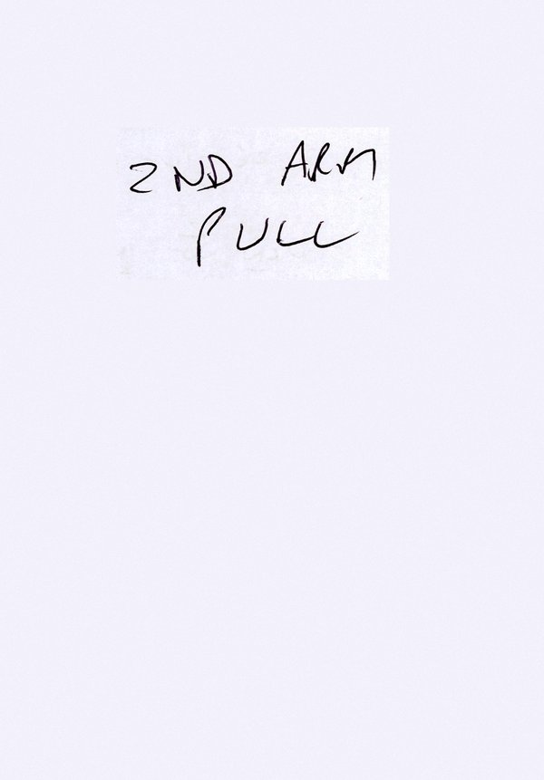

# gala-ocr

A Claude Code skill that transcribes scanned swimming-gala paperwork into structured JSON:

- **Lane sheets** printed by Hy-Tek Meet Manager, one lane of one event per sheet, filled in by hand: up to three
  timekeeper times per heat, check-in ticks, `N/S` and `DQ`, the Soft Touch box, and the timekeeper's signature.
- **DQ slips**: referees' handwritten disqualification reports (event, heat, lane, the infraction in the official's
  words, names, signatures, announcement time), including what's written on the back.

Claude reads the scans itself, so no API key, cloud OCR service or Tesseract install is needed. When you have the
PDF that Meet Manager printed, it takes the printed names, ages, teams and seed times straight from that, character
for character, and only has to read the handwriting.

## Install

```
/plugin marketplace add XRayA4T/Gala-AI-Plugins
/plugin install gala-ocr@gala-ai-plugins
```

**Requirements:** `python3` and poppler (`pdftoppm`, `pdftotext`, `pdfinfo`):

```bash
sudo apt install poppler-utils   # Debian / Ubuntu
brew install poppler             # macOS
```

## Use

Ask in plain words, or run `/gala-ocr`:

> Transcribe the lane sheets in `pdf/scanned/Lane Sheets.pdf` into `data/ocr`, using the original print in `pdf/original`.

> Read the DQ slips in `scans/DQs.pdf`.

> Redo pages 12 to 15 of the lane sheets.

Claude works through the scan in batches, writes one JSON file per sheet or slip as it goes, and checks every
file with the bundled validator. Then it lists everything a person should check against the paper: low-confidence
or unreadable times, crossed-out corrections, written-in names, N/S and DQ rows, unsigned sheets, and unreadable
slip fields. Pages that already have a file are skipped, so an interrupted run picks up where it stopped.

In a GalaAudit-style project (`pdf/scanned`, `pdf/original`, `data/ocr`) it finds the
files on its own; anywhere else it asks where the scans are and where to write.

## Examples

The [`examples/`](examples) folder holds a lane sheet and a DQ slip from a real gala, anonymised. Every swimmer,
club, official, signature and the meet and association names are replaced with made-up ones; the handwritten
times and infraction are the real handwriting. Each input comes with the transcription the skill should produce in
[`examples/expected/`](examples/expected).

### Original lane sheet (as Meet Manager printed it)

[`original-lane-sheets.pdf`](examples/original-lane-sheets.pdf) is a digital PDF with two sheets per A4 page, as Meet
Manager prints them before they're cut apart. The skill reads the printed names, ages, clubs and seed times from it
exactly, so Claude only has to read the handwriting.



### Scanned lane sheet (filled in by the timekeepers)

[`scanned-lane-sheet.pdf`](examples/scanned-lane-sheet.pdf): the same sheet after the race, with three timers'
times, check-in ticks, a corrected time in heats 4 and 6, two no-shows (N/S) and the chief timekeeper's signature.



Expected output: [`scanned-lane-sheet-event14-lane5-p001.json`](examples/expected/scanned-lane-sheet-event14-lane5-p001.json).
Heats 4 and 5 from it:

```json
{
  "heat": 4, "status": "SWAM", "swimmerName": "Williams, Jordan", "age": "12", "classification": "",
  "team": "EELS-XX", "seedTime": "42,78",
  "handTimes": [
    {"column": 1, "written": "39:34", "normalized": "39.34", "corrected": false, "confidence": "HIGH"},
    {"column": 2, "written": "39:22", "normalized": "39.22", "corrected": true, "confidence": "MEDIUM"},
    {"column": 3, "written": "39.44", "normalized": "39.44", "corrected": false, "confidence": "HIGH"}
  ],
  "checkedIn": true, "softTouch": false, "notes": ""
},
{
  "heat": 5, "status": "NO_SHOW", "swimmerName": "Davies, Kyle", "age": "15", "classification": "",
  "team": "TUNA-XX", "seedTime": "40,09", "handTimes": [], "checkedIn": false, "softTouch": false,
  "notes": "N/S written in timer column 1"
}
```

The timer in column 1 wrote `39:34` with a colon for the decimal point; on a 50 m race that can only be 39.34
seconds. `status` is `SWAM`, `NO_SWIMMER`, `NO_SHOW` or `DISQUALIFIED`. Each time keeps what was written
(`written`) next to its reading as `SS.hh` / `M:SS.hh` (`normalized`, empty when unreadable), with a `HIGH` /
`MEDIUM` / `LOW` confidence.

### Scanned DQ slip (front and back)

[`dq-slip.pdf`](examples/dq-slip.pdf): a referee's disqualification report, page 1 the front and page 2 the back,
where the official carried on writing.

<p>
  
  
</p>

Expected output: [`dq-slip-event08-heat1-lane2-p001.json`](examples/expected/dq-slip-event08-heat1-lane2-p001.json):

```json
{
  "sourceFile": "dq-slip.pdf", "page": 1, "backPage": 2, "date": "2026-10-10",
  "eventNumber": 8, "heat": 1, "lane": 2,
  "infraction": "Turn not initiated at completion of the arm pull after leaving position on the back 150m turn",
  "back": "2nd arm pull", "official": "A. Official", "referee": "B. Referee",
  "officialSigned": true, "refereeSigned": true, "announcementTime": "12:07", "initialled": true
}
```

### Try it

Copy the example PDFs into an empty folder, open Claude Code there, and ask:

> Transcribe `scanned-lane-sheet.pdf` into `out/`, using `original-lane-sheets.pdf` for the printed fields, then
> read the DQ slip in `dq-slip.pdf`.

Then compare `out/` with `examples/expected/`. The file names follow `<scan>-event%02d-lane%d-p%03d.json` for lane
sheets and `<scan>-event%02d-heat%d-lane%d-p%03d.json` for DQ slips (named for the slip's front page). The full
field rules are in [`skills/gala-ocr/SKILL.md`](skills/gala-ocr/SKILL.md).

## Bundled scripts

| Script | Does |
|---|---|
| `scripts/original_sheets.py ORIGINAL.pdf [EVENT [LANE]]` | Prints the lane sheets exactly as Meet Manager printed them, as JSON, from the original (digital) PDF |
| `scripts/validate_cache.py FILE_OR_DIR...` | Checks transcription files have exactly the expected fields, types, values and file names; exits 1 on any problem |

Both need only the Python standard library (plus `pdftotext` for the first) and can be run on their own.

## Accuracy

The output feeds an audit of official results, so the skill is told never to guess: a digit it cannot see is
marked `LOW` or left unreadable, and is listed for a person to check. Treat the transcription as a first pass that
points you at the sheets worth a second look, not as the official record.

## Privacy

Scans carry swimmers' names, ages, clubs and times, many of them children's. The skill keeps everything in your
project folder and renders page images to a temporary folder. Don't commit real scans or transcriptions to a public
repository.

## License

[MIT](../../LICENSE)
